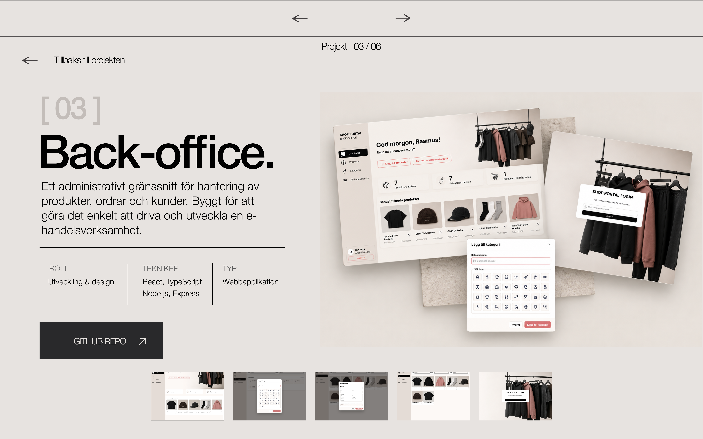
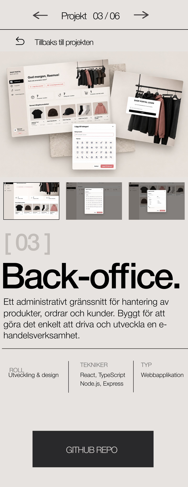

## Reflektion

### Komponentarkitektur och state

Jag har byggt min portfolio med React och TypeScript, med Vite som utvecklingsmiljö och SCSS för styling. Jag har delat upp sidan i mindre, återanvändbara komponenter utifrån deras funktion, exempelvis Hero, About, Projects och Contact. Projektkorten och projektfiltreringen har egna komponenter, vilket gör koden mer strukturerad och enklare att underhålla. Jag har även separerat projektinformationen från presentationen genom att samla den i en egen datafil.

Jag har använt React state där det behövs för att hantera interaktivitet. Exempelvis används state för projektfiltreringen och för kontaktformulärets fält, validering och återkoppling till användaren. React Router används för navigering till separata detaljsidor för projekten. Jag valde dessa tekniker eftersom de passade projektets omfattning och gav mig möjlighet att bygga en responsiv och interaktiv webbplats.

### Vad jag skulle göra annorlunda

Jag är nöjd med mina teknikval och resultatet, särskilt med tanke på att projektet genomfördes under två veckor. Jag tycker att designen och strukturen fungerar bra tillsammans och att jag lyckats skapa en portfolio som känns genomarbetad och personlig. I stället för att göra om några större delar skulle jag vilja fortsätta utveckla projektet med tiden, testa det ytterligare och förfina detaljer utifrån erfarenheter och feedback.

### Användning av AI

Jag har använt AI-verktyg som stöd under utvecklingen. Dels har jag använt AI för att skapa bilder till projektet, dels som ett pedagogiskt stöd när jag stött på nya tekniker eller problem. Jag har exempelvis använt AI för att förstå hur olika lösningar fungerar, felsöka och lära mig nya saker längs vägen. Målet har varit att förstå lösningarna och kunna använda dem i mitt eget projekt, snarare än att enbart kopiera färdig kod.

### Figma prototyp

